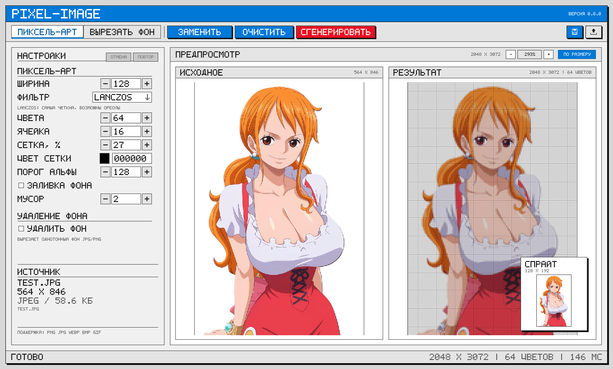
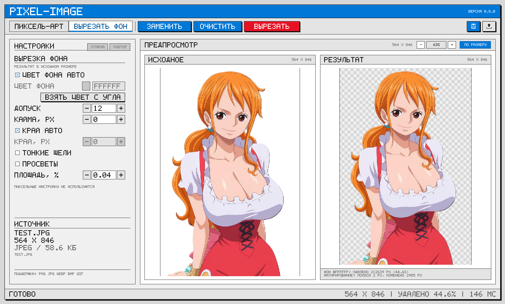

# pixel-image

**pixel-image** — офлайн-утилита на Rust, которая превращает изображение в
пиксель-арт с чёткой сеткой и умеет вырезать однотонный фон. На входе — один
файл, на выходе — один или два PNG. Без нейросетей, сети и внешних сервисов.

Проект собран как Cargo-workspace из четырёх крейтов: общее ядро
`pixel-image-core`, консольный интерфейс `pixel-image`, десктопное приложение
`pixel-image-gui` и его UI-библиотека `pixel-image-ui`.

`Rust 1.85+` · `v0.8.0` · Windows / Linux / macOS

## Два способа работы

Утилита решает две задачи. Их можно использовать по отдельности или вместе:
флаг `--remove-bg` вырезает фон прямо во время пикселизации.

### 1. Пиксель-арт (основной режим)



Изображение уменьшается до сетки заданной ширины (по умолчанию 128 px), палитра
сокращается методом median cut (по умолчанию до 64 цветов), а затем результат
увеличивается методом ближайшего соседа. Каждая ячейка становится ровным
квадратом, по её границам рисуется полупрозрачная сетка.

```powershell
pixel-image photo.jpg
```

Рядом с исходником появляются два файла:

| Файл | Размер | Содержимое |
| --- | --- | --- |
| `photo_grid.png` | `ширина_сетки × cell` | пиксель-арт с линиями сетки |
| `photo_sprite.png` | `ширина_сетки × высота_сетки` | чистый спрайт без сетки |

Для `test.jpg` (564×846) со значениями по умолчанию это сетка 128×192,
`_grid.png` 2048×3072 и `_sprite.png` 128×192.

В GUI: вкладка **ПИКСЕЛЬ-АРТ** → **СГЕНЕРИРОВАТЬ** → **СОХРАНИТЬ** (или
**ЭКСПОРТ**, чтобы выбрать папку и префикс).

Если фон однотонный, его можно убрать до пикселизации — тогда прозрачные ячейки
не попадут в палитру, а сетка будет нарисована только вокруг объекта:

```powershell
pixel-image photo.jpg --remove-bg
```

### 2. Вырезание фона (`--cutbg`)



Отдельный режим: изображение не пикселизуется и не меняет размер, а только
теряет однотонный фон. Результат — PNG с прозрачностью в исходном разрешении.

```powershell
pixel-image photo.jpg --cutbg
```

Получается один файл `photo_cut.png` (для `test.jpg` — 564×846). Цвет фона по
умолчанию определяется автоматически по периметру изображения; допуск 12
справляется с шумом JPEG, а матирование края включается само и убирает светлую
кайму.

В GUI: вкладка **ВЫРЕЗАТЬ ФОН** → **ВЫРЕЗАТЬ** → **СОХРАНИТЬ**.

Режим рассчитан на ровный однотонный фон (студийное фото, товар на белом). Флаги
пикселизации (`--width`, `--filter`, `--colors`, `--cell` и другие) с `--cutbg`
несовместимы — утилита сообщит об этом и завершится с кодом 2. `--remove-bg` в
этом режиме подразумевается.

> Скриншоты сняты встроенным headless-режимом `pixel-image-gui --dump-ui` на
> тестовом изображении `test.jpg`.

## Возможности

- **Два режима:** пиксель-арт (`_grid.png` + `_sprite.png`) и вырезание фона в
  исходном размере (`_cut.png`).
- **Управляемая палитра:** от 2 до 256 цветов, median cut с выбором коробки по
  суммарной ошибке.
- **Семь фильтров уменьшения:** `lanczos`, `catmull`, `triangle`, `gaussian`,
  `nearest`, `box`, `mode` — от чёткого фото до чистых краёв графики.
- **Прозрачность:** прозрачные области не пикселизуются и не попадают в
  палитру; альфа бинаризуется по порогу. Опция `--background` заливает
  прозрачные ячейки цветом.
- **Удаление фона:** заливка от краёв, автоопределение цвета, допуск под шум
  JPEG, матирование края, удаление тонких щелей и замкнутых просветов.
- **Чистка мусора:** `--despeckle` убирает изолированные островки ячеек,
  сохраняя самую большую группу.
- **Воспроизводимость:** одинаковый вход и флаги дают побайтово одинаковый
  результат — все «ничьи» в алгоритмах разрешены детерминированно.
- **GUI:** превью с зумом и панорамированием, drag&drop, окно экспорта,
  отмена/повтор, сохранение настроек, горячие клавиши.

## Установка и сборка

Требования:

- Rust 1.85 или новее (edition 2024) и Cargo;
- для GUI — GPU с поддержкой wgpu (DX12, Vulkan или Metal);
- CLI работает без GPU.

```powershell
cargo build --release
```

Готовые бинарники появятся в `target/release/`:

- `pixel-image.exe` — консольная утилита (на Linux/macOS — `pixel-image`);
- `pixel-image-gui.exe` — десктопное приложение.

Релизный профиль настроен на скорость: `opt-level = 3`, `lto = "fat"`,
`codegen-units = 1`, `panic = "abort"`, `strip = true`.

Тесты:

```powershell
cargo test --workspace
```

## Быстрый старт

### CLI

```powershell
# Пиксель-арт со значениями по умолчанию
.\target\release\pixel-image.exe photo.jpg

# Мелкий спрайт для игры
.\target\release\pixel-image.exe hero.png -w 48 -s 8 -c 24 -f mode --despeckle 3

# Фото на белом фоне: прозрачный пиксель-арт
.\target\release\pixel-image.exe photo.jpg --remove-bg -w 96

# Только вырезать фон, без пикселизации
.\target\release\pixel-image.exe photo.jpg --cutbg

# Свой префикс выходных файлов
.\target\release\pixel-image.exe assets\hero.png -p hero_32 -w 32
```

Через Cargo, не запоминая путь к бинарнику:

```powershell
cargo run --release -p pixel-image-cli -- photo.jpg --remove-bg
```

### GUI

```powershell
.\target\release\pixel-image-gui.exe            # пустое окно
.\target\release\pixel-image-gui.exe photo.jpg  # сразу с файлом
```

Приложение можно запустить и через Cargo:

```powershell
cargo run --release -p pixel-image-gui -- test.jpg
```

## Параметры CLI

```text
pixel-image [OPTIONS] <INPUT>
```

| Опция | По умолчанию | Назначение |
| --- | --- | --- |
| `<INPUT>` | — | входной файл: JPEG, PNG, WebP, BMP, GIF |
| `-w, --width <W>` | `128` | ширина сетки; высота считается по пропорциям |
| `-f, --filter <F>` | `lanczos` | фильтр уменьшения: `lanczos`, `catmull`, `triangle`, `gaussian`, `nearest`, `box`, `mode` |
| `-c, --colors <N>` | `64` | размер палитры, 2…256 |
| `-s, --cell <N>` | `16` | сторона ячейки в итоговом файле, px (≥ 2) |
| `-o, --grid-opacity <PCT>` | `27` | непрозрачность линий сетки, % |
| `-g, --grid-color <HEX>` | `000000` | цвет линий сетки |
| `--alpha-threshold <A>` | `128` | порог бинаризации прозрачности, 1…255 |
| `-b, --background <HEX>` | — | залить прозрачные области цветом (RGB на выходе) |
| `--remove-bg` | выкл. | вырезать фон перед пикселизацией |
| `--cutbg` | выкл. | только вырезать фон, без пиксель-арта |
| `--bg-color <HEX>` | авто | цвет удаляемого фона |
| `--bg-tolerance <T>` | `12` | допуск похожести на фон, 0…255 |
| `--bg-grow <N>` | `0` | снять N слоёв светлой каймы |
| `--bg-defringe <PX>` | авто | ширина полосы матирования; `0` — выключить |
| `--thin-gaps` | выкл. | удалять тонкие щели цвета фона |
| `--remove-holes` | выкл. | удалять замкнутые просветы фона |
| `--hole-area <PCT>` | `0.04` | минимальная площадь просвета, % изображения |
| `--despeckle <N>` | `2` | удалять группы ячеек меньше N; `0` — выключить |
| `-p, --prefix <NAME>` | имя входа | префикс выходных файлов |

HEX-цвета принимаются как `RRGGBB` или `#RRGGBB` (регистр не важен); сокращённая
запись `#RGB` не поддерживается.

Полная справка по флагам:

```powershell
.\target\release\pixel-image.exe --help
```

### Куда сохраняются файлы

- Без `--prefix` префикс — имя входного файла без расширения, папка — папка
  входного файла.
- Относительный `--prefix` (в том числе с подпапками) отсчитывается от папки
  входа; подпапка должна существовать.
- Абсолютный `--prefix` используется как есть.
- Совпадающие файлы перезаписываются.

### Коды возврата

| Код | Когда |
| --- | --- |
| `0` | успех |
| `1` | ошибка времени выполнения: файл не открылся, изображение полностью прозрачное, слишком большой результат |
| `2` | ошибка аргументов: неизвестный флаг, значение вне диапазона, несовместимые опции, неверный HEX |

## GUI

Окно разделено на панель настроек и превью «исходное / результат». Доступны:

- вкладки **ПИКСЕЛЬ-АРТ** и **ВЫРЕЗАТЬ ФОН**;
- открытие файла, drag&drop, пипетка «взять цвет с угла»;
- зум и панорамирование превью (`Ctrl` + `+`/`−`, колесо мыши, `Ctrl+0` —
  вписать, `Ctrl+1` — 100 %);
- быстрое сохранение рядом с исходником (`Ctrl+S`) и экспорт в выбранную папку
  с префиксом (`Ctrl+E`);
- отмена и повтор изменений настроек (`Ctrl+Z` / `Ctrl+Shift+Z`);
- сохранение параметров, последних файлов и размера окна.

Настройки лежат в `%APPDATA%\pixel-image\gui-settings.json` (Linux и macOS —
в пользовательском конфигурационном каталоге). Документ пишется атомарно;
повреждённый файл откладывается в `.bak`, а настройки сбрасываются.

## Структура проекта

| Путь | Крейт | Что внутри |
| --- | --- | --- |
| `crates/core` | `pixel-image-core` (lib) | вся логика обработки: уменьшение, палитра, сетка, вырезание фона |
| `crates/cli` | `pixel-image-cli` (bin `pixel-image`) | консольный интерфейс: флаги, отчёт, коды возврата |
| `crates/gui` | `pixel-image-gui` (bin) | окно, параметры, превью, вырезка, экспорт, настройки |
| `crates/gui/ui` | `pixel-image-ui` (lib) | Canvas, тема, bitmap-шрифт, виджеты и nearest-отрисовка |

Ядро не знает про консоль и GUI: интерфейсы собирают `Options` /
`BackgroundOptions`, вызывают `convert_file` / `cutout_file` (или
`convert_image` / `cutout_image` для работы в памяти) и сами показывают
статистику. Поэтому CLI и GUI дают одинаковый результат на одних и тех же
параметрах.

## Как это работает

Порядок обработки в режиме пиксель-арта:

1. очистка исходника: отсечение слабой альфы, при необходимости — вырезание
   фона, удаление щелей и матирование края;
2. уменьшение до сетки `--width` с выбранным фильтром (пропорции сохраняются);
3. бинаризация альфы по `--alpha-threshold`;
4. удаление островков на сетке (`--despeckle`);
5. гистограмма и палитра: median cut и ремап в ближайший цвет;
6. заливка прозрачных ячеек (`--background`), если задана;
7. увеличение nearest neighbour и отрисовка сетки;
8. сохранение PNG: RGB, если прозрачности нет, иначе RGBA.

В режиме `--cutbg` выполняется только шаг 1, а результат сохраняется в исходном
размере.

Подробное описание алгоритма — в [docs/pipeline.md](docs/pipeline.md) и
[docs/background-removal.md](docs/background-removal.md).

## Ограничения

- **Не сегментирует объект интеллектуально.** Удаляется только однотонный фон,
  связанный с краем изображения. Градиенты, виньетки и тени на фоне не
  удаляются.
- **Фон цвета объекта.** Если цвет фона совпадает с цветом объекта, объект
  тоже будет вырезан.
- **EXIF-ориентация не учитывается.** Фото с телефона может прийти боком —
  поверните его заранее.
- **Один вход — один запуск.** Пакетной обработки папок нет.
- **Увеличение только nearest neighbour.** Других вариантов апскейла нет:
  пиксели должны оставаться квадратными.
- **Прозрачность в спрайте бинарная.** После порога полупрозрачные пиксели
  становятся либо полностью непрозрачными, либо полностью прозрачными.
- **Анимация не обрабатывается.** Из GIF/WebP берётся первый кадр.
- **`--remove-holes` и `--thin-gaps` могут съесть нужные детали** (белую обувь,
  блики) — включайте их осознанно.

## Документация

| Документ | О чём |
| --- | --- |
| [docs/overview.md](docs/overview.md) | назначение, возможности, форматы, ограничения |
| [docs/usage.md](docs/usage.md) | полное описание CLI и примеры |
| [docs/pipeline.md](docs/pipeline.md) | алгоритм по шагам |
| [docs/background-removal.md](docs/background-removal.md) | вырезание фона и матирование |
| [docs/troubleshooting.md](docs/troubleshooting.md) | частые проблемы и рецепты |
| [docs/architecture.md](docs/architecture.md) | устройство workspace и публичный API ядра |
| [docs/performance.md](docs/performance.md) | скорость и память |
| [crates/gui/docs/SPEC.md](crates/gui/docs/SPEC.md) | спецификация GUI |
